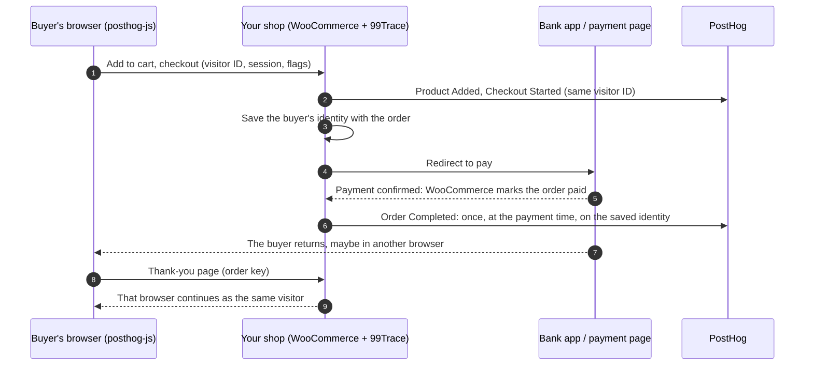

<p align="center">
  <picture>
    <source media="(prefers-color-scheme: dark)" srcset="brand/logo/99trace-wordmark-dark-background.svg">
    
  </picture>
</p>

<p align="center"><strong>Every WooCommerce order in PostHog, exactly once, on the visitor who placed it.</strong></p>

<p align="center">
  <a href="https://github.com/99ways-io/99trace-woocommerce-posthog/actions/workflows/ci.yml"></a>
  <a href="LICENSE"></a>
  
  
  
</p>

99Trace is a free, open-source WordPress plugin that connects WooCommerce to [PostHog](https://posthog.com). Your shop's server sends every purchase, refund and cancellation, so payment redirects, in-app browsers and ad blockers no longer lose orders, and posthog-js and the server share one visitor ID, so every event lands on the same person.

**[99trace.com](https://99trace.com)** · [Download the latest release](https://github.com/99ways-io/99trace-woocommerce-posthog/releases/latest) · [How it works](#how-it-works) · [Events](#events) · [Developers](docs/developers.md) · [Design](docs/design.md)

## Why

Most PostHog setups for WooCommerce record a purchase from the thank-you page, in the buyer's browser. That page is where tracking breaks:

- **Payment redirects.** Buyers pay in a banking app or on a payment page, then come back in another browser, where PostHog does not know them or is still waiting for cookie consent.
- **In-app browsers.** A shopper browses inside Instagram or Facebook, pays, and lands in Safari or Chrome: one buyer, two visitors.
- **Ad blockers.** When PostHog is blocked, the purchase is never recorded.
- **Reloads.** A reloaded thank-you page records the same order twice.

Because the loss depends on payment method and device, it can bias an A/B test, not only shrink it.

## How it works



- **Exactly once.** Each order event is built once, frozen on the order and sent with a UUID derived from the order. Retries are byte-identical, so PostHog collapses any duplicate. Failures retry for about two days, and an hourly sweep queues paid orders that were missed.
- **Identity before the redirect.** The buyer's PostHog identity is copied into the checkout and saved with the order before they leave for the payment page.
- **One writer of identity.** posthog-js alone writes PostHog's identity. Signed-in customers are identified with an opaque account ID, never an e-mail address.
- **Consent decides the link.** An order without consent can still be counted, without anything that identifies the buyer.
- **Coverage is reported.** WooCommerce → Status → 99Trace shows how many paid orders were sent and how many are linked to a visitor.

The full design, with the reasons behind each choice: [docs/design.md](docs/design.md).

## Features

- Server-side `Order Completed`, `Order Refunded`, `Order Cancelled` and `Payment Failed`, exactly once.
- Server-side cart and checkout events, also when PostHog is blocked in the browser.
- One first-party visitor ID shared by posthog-js and the server; the thank-you page joins a returning browser to the buyer.
- An optional browser module that runs posthog-js: page views, page leave, autocapture, heatmaps, web vitals, replay, surveys and error tracking, each following your PostHog project's settings or overridden from WordPress.
- Consent: track every visitor, or follow Cookiebot or the WP Consent API, with three choices for what happens before the visitor answers.
- Safe for experiments: flags keep working and the flags a buyer had at checkout are copied onto the purchase.
- Block and classic checkout, HPOS, and custom checkouts such as FunnelKit.
- Test mode, a lock that stops staging copies from sending into your live project, and exclusion of shop staff, page editors and previews.
- Events can be switched off or renamed; personal data export and erasure; a suggested privacy policy text; translation-ready.

## Events

| Event | Sent from | When |
| --- | --- | --- |
| `Order Completed` | Server | The order is paid (once, at the payment time) |
| `Order Refunded` | Server | A full or partial refund of a sent purchase |
| `Order Cancelled` | Server | A sent purchase is cancelled |
| `Payment Failed` | Server | Payment fails or is cancelled before the order was paid |
| `Checkout Started` | Server | The checkout opens with items in the cart (once per cart per 30 minutes) |
| `Product Added` / `Product Removed` | Server | WooCommerce changes the cart |
| `Coupon Applied` / `Coupon Removed` | Server | A coupon is added or removed |
| `Product Viewed`, `View Category`, `Cart Viewed` | Browser | A product, category or cart page is viewed |
| `Order Confirmation Viewed` | Browser | The thank-you page is seen (once per order and browser) |
| `$pageview`, `$pageleave`, `$autocapture`, `$dead_click` | posthog-js | PostHog's own events |

Every property and its source: [docs/properties.md](docs/properties.md).

## Installation

Requirements: WordPress 6.5+, WooCommerce 8.7+, PHP 8.0+, and a PostHog project (PostHog Cloud EU or US, or self-hosted).

1. Upload the zip from the [latest release](https://github.com/99ways-io/99trace-woocommerce-posthog/releases/latest) under Plugins → Add New → Upload. 99Trace is in review for the WordPress.org plugin directory; once it is listed there, you can install and update it from Plugins → Add New.
2. Open **WooCommerce → 99Trace**, enter your PostHog project API key and host.
3. Set the mode to **Test**, place a test order and read the events in WooCommerce → Status → Logs (source `99trace`).
4. Choose your consent setting, switch on **Run PostHog in the browser** once any other PostHog plugin or snippet is removed, and set the mode to **On**.

Every setting explains itself on its page.

### Switching from 99Hog for WooCommerce

99Trace is the new name of 99Hog for WooCommerce (0.2 to 0.6, piloted on live shops). Install and activate 99Trace, deactivate 99Hog (99Trace waits with a notice while 99Hog is active), then clear your page cache. Settings, queued events and visitor IDs carry over: stored names keep their `w99_phwc_` prefix and event IDs keep their `99hog:v1:` scheme. Server events now carry `$lib: 99trace`.

## Privacy

99Trace sends data only to the PostHog project you configure, and only once you set the mode to On. It never sends postal addresses or order keys, never uses an e-mail address as an ID, and removes order keys and e-mail addresses from every URL. Customer details on the person (e-mail, name, phone) are optional and only for visitors who may be recorded. WordPress's privacy tools export and erase what 99Trace keeps on orders. What is sent, and when, is listed in the [readme's External services section](99trace-posthog-for-woocommerce/readme.txt).

## Development

```sh
php tests/unit/run.php                                  # PHP unit tests (no WordPress needed)
for t in tests/unit/*.mjs; do node "$t"; done           # browser module unit tests
tests/run.sh                                            # 200+ checks on a throwaway WordPress + WooCommerce (Playground)
bin/build-zip.sh                                        # dist/99trace-posthog-for-woocommerce-<version>.zip, as WordPress.org receives it
```

Pull requests also run [Plugin Check](https://wordpress.org/plugins/plugin-check/), the WordPress.org review tool, on every change. Release 1.0.0 passes all of its categories with no errors or warnings.

| Path | What it holds |
| --- | --- |
| `99trace-posthog-for-woocommerce/` | The plugin, exactly as it ships |
| `tests/` | Unit tests and WordPress Playground checks |
| `docs/` | Design, properties and developer hooks |
| `brand/` | Logo, icon, colours and the build that regenerates them |
| `website/` | [99trace.com](https://99trace.com): the page, its build and the Cloudflare Worker that serves it |
| `.wordpress-org/` | Icon, banners and screenshots for the plugin directory |
| `bin/` | Release build |

## Contributing

Issues and pull requests are welcome: see [CONTRIBUTING.md](CONTRIBUTING.md). Please report security issues privately, as described in [SECURITY.md](SECURITY.md).

## License

GPL-2.0-or-later. Built and maintained by [99Ways](https://99ways.io).

99Trace is not affiliated with or endorsed by PostHog Inc. or by WooCommerce and Automattic. PostHog and WooCommerce are trademarks of their respective owners.
