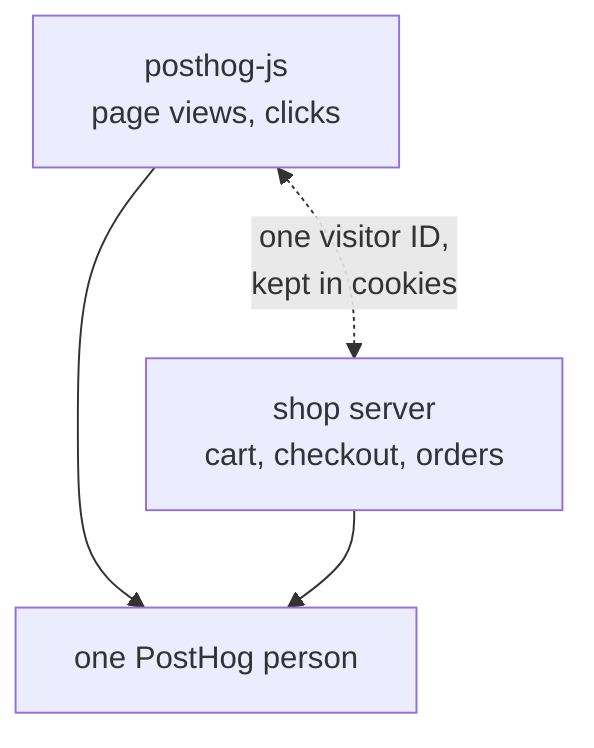
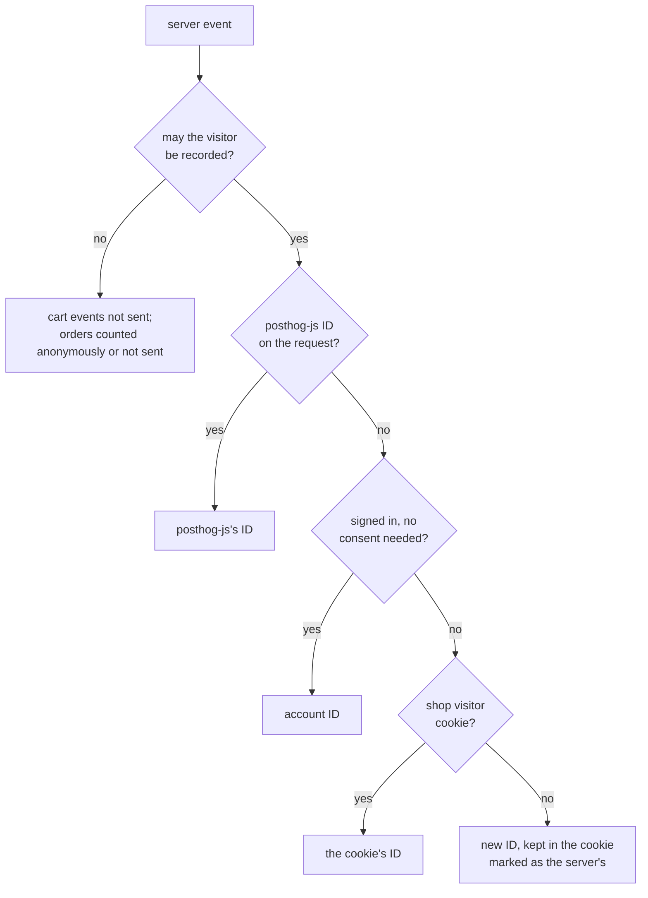
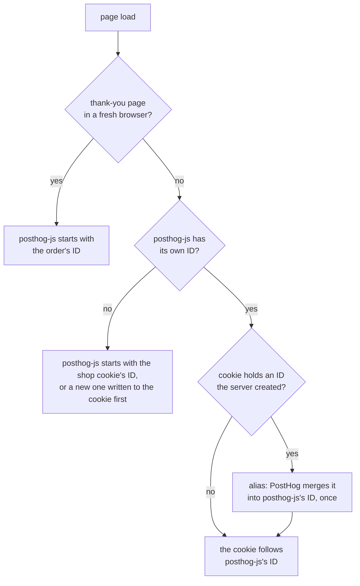

# Design: one identity across browser and server

Status: implemented in 0.3.0 (2026-11-12); one visitor ID for browser and server since 0.5.0 (2026-11-16). Replaces the 0.2.x design (server events beside another plugin's posthog-js, person ID from the e-mail hash).

## What the plugin is for

PostHog data a shop can take decisions on: conversion rates and revenue per visitor that do not depend on the buyer's browser finishing the purchase, attribution that survives the bank app, and experiment results that are not biased by payment method or device. The browser records behaviour (posthog-js); WooCommerce's server records outcomes; both use the same PostHog identity.

## Identity

### Evidence, strongest first

| Evidence that two interactions belong to one buyer | Where it comes from | How PostHog is told |
| --- | --- | --- |
| Same browser | posthog-js's own cookie and storage | Nothing to do: one distinct ID |
| Same browser, before posthog-js has an ID, or without posthog-js (ad blocker) | The shop's visitor-ID cookie `ph_wc_vid`, written by the browser module or the server, whichever needs an ID first (0.5.0) | Nothing to do: posthog-js starts with that ID (bootstrap), and the server sends under it |
| The browser placed the order | The checkout request itself (envelope in the form, or posthog-js's cookie on that request) | The order is stamped with that browser's identity; every server event about the order uses it |
| The thank-you page was opened with the order's secret key | WooCommerce shows the order to whoever holds the key (`order-received`, and FunnelKit's thank-you page; not the order-pay page, which comes before payment) | Browser without PostHog history: posthog-js is bootstrapped with the buyer's distinct ID (no merge). Anonymous browser with its own history: `alias` asks PostHog to merge it into the buyer |
| The visitor signed in to a customer account | WordPress authentication | `identify` with an opaque account ID `wc:<host>:<user ID>`, read from a cookie the shop sets at login |
| The same e-mail address typed at a guest checkout | Unverified text | **Not used.** Recorded only as `returning_customer` on the purchase |

### The scenario this was built for

A visitor opens an Instagram or Facebook ad in the app's in-app browser (A), pays in a banking app, and the banking app opens the thank-you page in the phone's default browser (B).

1. A loads posthog-js after consent: anonymous distinct ID `A`, session `S`.
2. At checkout the browser module copies `A`, `S`, the device ID, consent state, active flags and a snapshot of posthog-js's event properties (browser, device, screen, URL, session entry URL, referrer, UTM and click IDs) into the checkout form. The server freezes that on the order, with the buyer's IP and user agent and the server's time.
3. The bank confirms by webhook (no browser at all). WooCommerce marks the order paid. `Order Completed` is sent by the server under `A`, timestamped at the payment, with the session `S` attached while it is still running.
4. B opens the thank-you page. The page carries the order's identity (only because the URL holds the order key; the page is not cached). After consent in B:
   - B has no PostHog history (the usual case): posthog-js starts **as `A`** (bootstrap, same device ID, and session `S` if it is under 30 minutes old). Everything B does from now on is the same visitor. No merge, no identified person.
   - B already has its own anonymous history `B'`: posthog-js in B calls `alias(A)`, and PostHog merges `B'` and `A` into one person, so B's earlier visits (first touch) and the purchase share a person.
   - B is signed in to a customer account: nothing is merged (a shared device must not absorb another identity). Recorded as `identified_browser_not_joined`.
5. B sends `Order Confirmation Viewed` once, with `return_context` = `same_browser`, `new_browser_continued`, `known_browser_alias_sent`, `identified_browser_not_joined` or `not_linked`. That makes the cross-browser return measurable. `known_browser_alias_sent` records the request; PostHog decides the merge (see the limits below).

If the buyer never opens the thank-you page, or never gives consent in B, the purchase is still recorded under `A`; only B's later browsing stays separate.

### One visitor ID for browser and server (0.5.0)

The shop's server sends what WooCommerce sees: cart, coupon and checkout events (WooCommerce's cart hooks catch every way of adding to the cart, whatever the theme or checkout) and the order's events. posthog-js sends what happens in the page. Both use one visitor ID, so PostHog never has to merge two IDs of one visitor in one browser.

The ID lives in two first-party cookies: posthog-js's own (`ph_<key>_posthog`), and the shop's `ph_wc_vid`, which the server can read before posthog-js has written anything. Whoever needs an ID first creates it, and the other side uses the same one.

Which ID a server event is sent under (an order first takes the identity in its checkout envelope, then the same order):

What the browser module does on each page, where the visitor may be recorded:

| Journey | Server events go under | How the two sides meet | PostHog merge |
| --- | --- | --- | --- |
| posthog-js loads first (most visitors) | posthog-js's ID | The server reads posthog-js's cookie | none |
| Click before posthog-js loads | The ID the module wrote | posthog-js starts with it | none |
| "Add to cart" link as the landing page | A new ID from the server | posthog-js starts with it on that page | none |
| posthog-js never loads (ad blocker) | The ID the module wrote, cart to purchase | One server-only person | none |
| Thank-you page in a fresh browser (bank app) | The order's ID | That browser continues it | none |
| Thank-you page in a browser with its own history | The order's ID | That browser joins the buyer | `alias` |
| Returning customer signs in | The account ID after sign-in | The visitor ID joins the account | `identify` |
| Cookies cleared, site storage kept: the server created an ID while posthog-js had another | The server's new ID | The browser merges it into its own | `alias` |

Merges are left for joins across browsers or devices, where they are the right tool. PostHog marks a person "identified" after any `alias` or `identify` and then refuses to merge it into another existing person (an ingestion warning, not an error; `person_profiles` does not change this). Merging every cart session into its browser with `alias` would therefore have broken the later joins for those visitors: a returning customer's sign-in, a thank-you page in a browser with its own history, and any `identify` the shop's other tools make. Joining in one browser by sharing the ID leaves those persons unmerged, so the cross-browser merges still go through. `$merge_dangerously` (no safety check, cannot be undone) is never sent.

The first 0.5.0 build (PR #4) held such events in the database for the visitor's WooCommerce session until posthog-js had an ID. Sharing the ID needs no storage on the server, sends each event at once with its own time, and has no 30-minute wait for visitors whose posthog-js never loads.

What the order adds across browsers is unchanged: WordPress has no visitor ID that crosses from an in-app browser to the default browser; the order does. The checkout copies the visitor's ID, device, session and a snapshot of posthog-js's properties onto the order, and the order key joins the browser the buyer returns in.

An order placed before the visitor answered the banner (consent modes) is unlinked at checkout. When the visitor accepts on its thank-you page, the browser module sends its ID with the order key (`?wc-ajax=w99_phwc_link`). The server links the order only if:

- it is a guest's order, unlinked for want of consent (never after a refusal), and placed within the thank-you link's age (24 hours, filter `w99_phwc_return_link_max_age`);
- its purchase is not built yet;
- the request's own consent allows it, from a capturing posthog-js;
- the ID is an anonymous visitor's (never an account or an identified person).

The purchase is frozen (`sending`) before its identity is read from the database, so a link that came first counts and a later one is refused. A link and the build landing in the same instant can still disagree; the order box then shows the link while the purchase went out without it. Cart events from before the answer are not sent.

The cookie is written only where the visitor may be recorded (the Consent setting):

- **By the browser module:** where posthog-js may store its own ID, rewritten on every page (Safari keeps a script's cookie 7 days from its last write).
- **By the server:** only when consent is given or none is needed, never on consent inferred from older cookies; only when no browser module ran on the checkout; never for crawlers, link previews or scripts; and only on responses no page cache keeps (cart actions, checkout).

It is deleted with PostHog's storage on a refusal, under the site's cookie path as well as `/`, and cleared at logout (the anonymous ID may have been joined to the account). It is never printed into page HTML and holds a random UUID only. It is no evidence of consent for the server: it outlives the consent platform's record. It is used only where 99Trace's browser module runs: beside another plugin's posthog-js it would split visitors.

### Identity of each event

| Event | distinct_id | Person processing |
| --- | --- | --- |
| Browser events | posthog-js's distinct ID | posthog-js `person_profiles` (default `always` since 0.4.0) |
| Server events about an order | The identity frozen at checkout | Same as the browser at checkout: anonymous visitors stay personless (`$process_person_profile: false`), so their purchase gets the same `person_id` as their exposures without creating a person. With the person profiles setting at "every visitor", server events process the person too |
| Server cart, coupon and checkout events | posthog-js's cookie on that request; else the account (signed in, no consent needed); else the shop's visitor ID, created if there is none (with consent given or not needed) | As the cookie says; for the shop's ID, the person profiles setting (as posthog-js treats an anonymous visitor) |
| Order with consent but no PostHog ID in the checkout (ad blocker, script failed) | The shop's visitor ID (the module writes it although posthog-js is blocked); `99hog:order:<uuid>` only when no cookie can be written | As above; `99hog:order:` IDs never a person |
| Order without consent | Not sent (setting: count anonymously instead) | — |

The identity frozen at checkout is refreshed only by the same visitor (block checkout's draft order, then the submission) or by a sign-in during checkout. A payment retry from another browser, or from one without consent, never replaces it.

`identity_source` on every server event says where the identity came from (`browser`, `cookie`, `shop_cookie`, `customer_account`, `parent_order`, `legacy_0_2`, `none`), `identity_reason` why an order is unlinked, `consent` what the consent record said.

### What cannot be linked

- Purchases by buyers who refused statistics consent: not sent by default; nothing in PostHog describes them.
- A browser the buyer returns in without giving consent there: its activity is not recorded at all.
- A browser where PostHog was blocked (ad blocker without a reverse proxy): its page events are not recorded. Its cart, checkout and purchase are on the shop's visitor ID: one person, without browsing.
- A click that leaves the page before posthog-js has finished loading: that page's browser events are lost. Its server events carry the shop's visitor ID, which posthog-js starts with on the next page.
- Cart events made before the visitor answers the banner (consent modes): not sent. The order is linked if the visitor accepts on its thank-you page before it is sent.
- Two guest orders by the same person from browsers that never met: different persons. Only `returning_customer` tells that WooCommerce has seen the buyer's e-mail or account before.
- A thank-you page opened more than 24 hours after the order (filter `w99_phwc_return_link_max_age`), or for a registered customer's order (signing in links them).
- PostHog's merge rules: `alias` from B is refused when the buyer's person is already identified (for example, a third browser joined it first, or the buyer was signed in). A browser joined by `alias` that later signs in to an account whose person already exists stays a separate person from that account (PostHog does not merge two identified persons without `$merge_dangerously`, which this plugin never sends). The shared visitor ID adds no merge of its own, except in the rare case above (cookies cleared, site storage kept).

## Events

| Event | Sender | When | Once per |
| --- | --- | --- | --- |
| `$pageview`, `$pageleave`, `$autocapture`, `$dead_click`, `$rageclick`, web vitals, flags, replay | posthog-js | as posthog-js does | — |
| `Product Viewed` | browser | product page | page view |
| `View Category` | browser | product category page | page view |
| `Cart Viewed` | browser | cart page | page view |
| `Order Confirmation Viewed` | browser | thank-you page | order and browser |
| `Checkout Started` | server | checkout page with a cart (also when a funnel fills the cart while the page renders) | cart contents per 30 minutes |
| `Product Added` / `Product Removed` | server | WooCommerce changes the cart (any button, block, funnel, URL) | change |
| `Coupon Applied` / `Coupon Removed` | server | WooCommerce applies or removes a coupon | change |
| `Order Completed` | server | order paid (payment complete, a paid status, or a status another plugin sets on an order with a payment date), sent after the upsell wait | order |
| `Order Refunded` | server | refund created; sent after the purchase | refund |
| `Order Cancelled` | server | a paid order is cancelled; carries what refunds did not already reverse; timestamped at the cancellation | order |
| `Payment Failed` | server | an unpaid web order moves to failed or cancelled | transition |

Server cart and checkout events are recorded on the request that renders the page. WordPress (6.8+) asks browsers to prefetch same-site links, by default when the shopper presses on one, so a funnel checkout (which fills its cart while rendering) is often requested by that prefetch just before the click completes, and the click shows the prefetched page without asking the shop again. A press, or a touch while scrolling on a phone, also prefetches pages the visitor never opens: 3 of the 4 prefetched checkouts on a live shop in the first 15 hours of 0.5.1. Since 0.6.0 the events of such a request wait until the page is shown: the server keeps them for 30 minutes under a single-use token printed into the page, and 99Trace's browser module, which a prefetched page runs only once it is shown (a prerendered one after `prerenderingchange`), reports the token to `?wc-ajax=w99_phwc_shown`. The server then sends them as recorded, marked `speculative_load: true`; a Checkout Started whose cart was counted meanwhile is dropped. Without 99Trace's browser module on the page they are sent at once, marked. Filtering `speculative_load` events out would drop real checkouts, because a prefetched page that is opened is never requested again.

A cart the checkout page fills while it loads (`source: checkout_page`: FunnelKit funnels fill it at `template_include`) is not sent as `Product Added` unless Events → "Carts the checkout page fills" is Sent; Checkout Started carries the products. The line is WooCommerce's own `is_checkout()` after the main query, not a FunnelKit check, so a `?add-to-cart=` link to the checkout still counts as the shopper adding.

Who is recorded (Visitors & orders): signed-in users who can manage orders (`edit_shop_orders`: administrators, shop managers), users who can edit pages but not orders (`edit_pages`: editors, custom page-building roles) and preview loads (Elementor's editor frame and preview, WordPress previews, the Customizer, FunnelKit's previews, and AJAX or REST calls whose referrer is one of them) are not recorded by default: no browser module, no cart, coupon, checkout or person events. A purchase such a user makes is still sent, without the identity of their visits. Only signed-in users count as previews. `Audience` holds the rule; the 0.5 filter `w99_phwc_track_staff` still records staff, and `w99_phwc_record_user` decides per user.

Revenue nets to zero over a cancelled order in any order of events: a refund made after the cancellation was built carries `revenue` 0 (`refund_amount` keeps the amount, `after_cancellation: true`); a cancellation reverses only what earlier refunds did not. An order reinstated before its cancellation is sent sends none; reinstating it after the cancellation was sent is not reflected.

Property names and their sources: [properties.md](properties.md).

## Consent

- **Browser:** nothing loads before statistics consent. The module follows Cookiebot (`CookiebotOnConsentReady`, `OnAccept`, `OnDecline`) or the WP Consent API; with "My site calls posthog.opt_in_capturing()" posthog-js starts opted out. Declining or withdrawing stops capture and deletes posthog-js's cookies (at every domain level it may use), its storage and the account cookie. Consent given again on a later page resumes capture, also where posthog-js still holds an earlier opt-out.
- **"Automatic"** resolves to the consent platform the site runs (the Cookiebot plugin, else the WP Consent API). With neither found the browser module stays off and an admin notice asks for an explicit choice: a banner added by the theme or Google Tag Manager is invisible to the server, and loading posthog-js before it answers would track visitors who decline. "Not required" is an explicit setting.
- **Consent switch** (setting, off by default; with Cookiebot or the WP Consent API): posthog-js starts at page load switched off (`opt_out_capturing_by_default`, `opt_out_persistence_by_default`, and any earlier opt-in mark cleared), so feature flags, and with them experiment variants, are answered at once. Before consent posthog-js sends no event and stores nothing (no cookie, no localStorage); its only request is the flag request, under a random ID held in memory. On consent it switches on and sends the page view and the exposures it held back, under the same visitor ID. A refusal leaves it switched off with nothing stored, and the next page starts switched off again. Until consent every page load has a new random ID, so a visitor who browses several pages before answering can see a different variant on each; the exposure that counts is the one from the page they consent on. Same mechanism as the 99Ways page-experiment template, which starts posthog-js the same way for sites whose own plugin waits for consent.
- The loader carries `data-cookieconsent="ignore"` only when the module waits for consent itself, so Cookiebot's auto-blocking does not hold back a loader that already respects it.
- **Server:** the consent platform's record decides (Cookiebot's `CookieConsent` cookie, or the WP Consent API) on the checkout and cart requests; posthog-js's opt-in/out cookie only where no platform has answered. With no record at all but a posthog-js identity, consent is `implied`: on these shops posthog-js only runs after consent. An envelope from a switched-off posthog-js and the shop's visitor cookie are no such evidence. With the WP Consent API, its answer decides alone: `false` means "not answered yet" (or an answer that expired; it keeps one 30 days) until a refusal is stored (`<prefix>_statistics=deny`, prefix from `wp_consent_cookie_prefix`), whatever cookies remain from earlier.
- **Default for new installs (0.5.0):** "Track every visitor", and orders without consent counted anonymously. The decision is the shop owner's; every mode stays available, and a shop updated from 0.4.0 that never saved these settings keeps "Automatic" and "Not sent".
- The consent state at checkout decides the order's linkage, and is recorded on the order and on its events.

## Personal data

- Customer details (0.5.0, on by default): e-mail, first and last name, full name and phone as person properties (`$set`) when known: typed on the checkout (browser), on the paid purchase and at sign-in or account creation (server). Only where the visitor may be recorded, never on an anonymous order, never in event properties or URLs. PostHog's destinations normalise and hash them for Meta and Google Ads. This replaces 0.3.0's rule that no e-mail reaches PostHog.
- Never sent: postal addresses, order keys.
- The browser module removes order keys (any parameter holding `wc_order_…`, also inside encoded URLs), e-mail addresses and the configured URL parameters from every string of every event, at any depth (web vitals URLs, heatmap data keyed by URL, autocapture's element chain), and from the checkout snapshot. Replay data is left to posthog-js's masking.
- posthog-js also stores the visitor's first URL and referrer and sends them as person properties (`$initial_current_url`, `$initial_referrer`) with every feature-flag request, which `before_send` never sees. A browser whose first page is a thank-you page (the buyer returning from the bank app) would send its order key with every later flag request. The module cleans those stored values at load and in `before_send`, which runs in the same call as posthog-js's first write of them. posthog-js's own `custom_personal_data_properties` applies only together with `mask_personal_data_properties`, which also masks the ad click IDs (`gclid`, `fbclid` and others), so it is not used.
- Order-received, order-pay and account pages show the buyer's details: autocapture keeps clicks without element text or attributes, and replay and heatmaps are off there.
- WooCommerce's attribution URLs on `Order Completed` are stripped the same way; for an order counted without consent they are left out.
- The account ID reaches the browser in a cookie set at login (and on cart, checkout and account pages, which are never cached), only with consent. Page HTML is the same for every visitor of a URL, so a page cache cannot hand one customer's identity to everyone.
- WordPress's personal data export lists what the plugin keeps per order; WooCommerce's order eraser removes the buyer's IP, user agent, URLs and browser snapshot from it and keeps the delivery state and pseudonymous IDs. Data in PostHog is erased there (delete the person).

## Delivery

- Order events: requests only enqueue. Action Scheduler sends to `<host>/batch/` in the background. Every hook runs inside WooCommerce's checkout, payment and status code, so every one catches and logs its own failures; the sweep recovers what they missed.
- Behavioural events (cart, coupon, checkout, payment failures; 0.5.0): collected during the request and sent in one batch at its end, after WooCommerce saved the session and after the response has gone to the shopper (`fastcgi_finish_request`, or LiteSpeed's equivalent; filter `w99_phwc_finish_request_first`), with one quick retry. Nothing is written to the database unless PostHog cannot be reached. Then:
  - each event is kept (payload in a transient) and retried by Action Scheduler (1 min, 5 min, 30 min, 2 h);
  - for five minutes, later requests keep their events at once instead of waiting on PostHog (one transient), so an outage does not hold PHP workers.

  Outside a shopper's request (cron, Action Scheduler, CLI, admin) there is no response to hand over, so events are sent at once. Without PHP-FPM or LiteSpeed the shopper's request waits for PostHog's answer (4 s at most per try).
- Each order event is built once and frozen on the order (identity, payload, UUID, timestamp); retries send it byte for byte, so PostHog collapses duplicates (same UUID, event, distinct ID, UTC day). UUIDs are UUIDv5 over `99hog:v1:woocommerce:<host>:<kind>:<ids>` (namespace shared with the other 99Trace integrations).
- One pending action per event: the action names the event (kind, order, refund), the attempt count lives in the event's state, and a delivered state is never overwritten by a late failure.
- Backoff: 1 min, 5 min, 30 min, 2 h, 6 h, 12 h, 24 h. An hourly sweep looks at every order paid in the last three days (any status) and re-queues purchases never queued or whose task was lost, refunds and cancellations of delivered purchases, and events PostHog refused (401/403) for a project key that has since been changed.
- Refunds and cancellations follow a purchase PostHog received: a refund made during the upsell wait is sent right after the purchase; a purchase only logged in test mode never reached PostHog, so after switching to On its refunds are not sent either.
- A copy of the shop that carries the live settings (staging, a developer's machine) stops sending: sending is tied to the site address recorded when it was first switched on, and an administrator confirms a new address from the admin notice. The address is stored base64-encoded: moving a copy to its own address (`wp search-replace`, migration plugins) rewrites every plain copy of the old address, which made a plain record follow the copy.
- Upgrade from 0.2.x in place: orders already sent by 0.2.x (`_99w_ph_sent_at`) are never re-sent; their refunds and cancellations are sent under 0.2.x's person (hashed e-mail, or the visitor with its identify setting off) while the project key is still the one 0.2.x sent to; queued 0.2.x tasks are routed into the new queue; 0.2.x identify tasks are dropped. 0.3 also writes `_99w_ph_sent_at` on what it sends, so a rollback to 0.2.x does not send it again.

## posthog-js

- Loaded from PostHog's CDN (`array.js`, always the current version) with `defaults: '2026-08-30'`, which pins posthog-js's behaviour defaults. The server reads posthog-js's cookie defensively (unknown formats give no identity, not wrong ones). Tested with posthog-js 1.447.15.
- `persistence_save_debounce_ms: 0`: the 2026-05-30 defaults delay storage writes by 250 ms and flush them on `pagehide`, which loses the race with the next request; the server then saw a click on "buy" right after posthog-js loaded without any identity.
- Only posthog-js's built-in properties are kept in the cookie. Session entry attribution stays in localStorage: copying its URLs into the cookie can push it past the browser's 4 KB limit, and with the 2026-08-29 defaults a stale cookie then wins over localStorage. Server cart and checkout events carry the session ID, so PostHog's session attribution covers them; purchases carry the full snapshot.

## Time

Every timestamp is true UTC from `getTimestamp()` (never `WC_DateTime::date()`, which labels shop time as UTC: the 0.2.0 bug). `Order Completed` is timestamped at the payment, `order_placed_at` holds the order time, refunds at their creation, cancellations at the status change. Whether the checkout session still runs is judged on the server's clock, never the phone's.

## Location

Server events carry the buyer's IP (WooCommerce's recorded customer IP, from the checkout request) as `$ip`, so PostHog's GeoIP locates the buyer. Private or missing IPs set `$geoip_disable` instead: the shop server's location is never used. Turn off with "Pass the buyer's IP".

## Experiments

- Exposures stay in posthog-js. Purchases need no flag property: PostHog joins them to the person's first exposure through `person_id`, and personless purchases share the anonymous visitor's derived `person_id`.
- The variants active at checkout are copied as `checkout_flags` (read from storage, so no `$feature_flag_called` is created), plus `$active_feature_flags`.
- The bootstrap in a returning browser keeps the device ID, so device-bucketed flags give B the same variant as A.
- With the consent switch, posthog-js holds exposures read before consent and sends them on consent (posthog-js 1.447.15, staging journey CS1: one `$feature_flag_called` with the variant shown, same distinct ID as the page view). An experiment runtime may therefore read flags at page load with exposures on.
- Before reading a result, compare the linked share of purchases per arm (WooCommerce → Status → 99Trace).

## Settings

WooCommerce → 99Trace (WooCommerce → Settings → 99Trace; 0.3.0's address under Advanced redirects there), in tabs. **Connect**: Mode Off / Test (capture and log, send nothing) / On; project key and host; browser on/off and proxy host. **Consent**: consent source or "Track every visitor"; before the answer: wait / record the visit and send it on consent / switched off (experiments only); keep the recording across pages; orders without consent. **Events**: one row per event (server, browser, PostHog automatic) with its switch and, except PostHog's own events, a custom name (applied when the event is built, so the UUID and exactly-once delivery are unchanged; names starting with "$", over 100 characters or taken by another event are refused). **Browser features**: replay, heatmaps, web vitals, rage clicks, surveys, flags, cross-subdomain cookie, error tracking, hide all text, as posthog-js options under the JSON below. **Visitors & orders**: person profiles, customer identify, one visitor ID for the browser and the shop (0.5.0), return-browser link (also links an order placed before consent), buyer IP, upsell wait. **Advanced**: URL parameters never sent; further posthog-js options (JSON) and the 0.3.0 details below; pilot visitor key; debug log. In 0.3.0 terms: "Run PostHog in the browser" (off on upgrade; refused while another PostHog plugin is active, because two posthog-js instances split every visitor); browser proxy host; consent source; consent switch; person profiles (browser and server events); further posthog-js options (a JSON object passed to `posthog.init`; the keys the plugin owns, such as host, key, persons, persistence, consent and `before_send`, are ignored, invalid JSON is ignored with an admin notice; filter `w99_phwc_posthog_js_config`); autocapture, page leave, dead clicks; customer identify; return-browser link; orders without consent; each server and browser event; buyer IP; upsell wait; URL parameters never sent (order keys, nonces, e-mails); debug log.

Per order: the "PostHog (99Trace)" box on the order screen shows the frozen identity and each event's delivery state.
